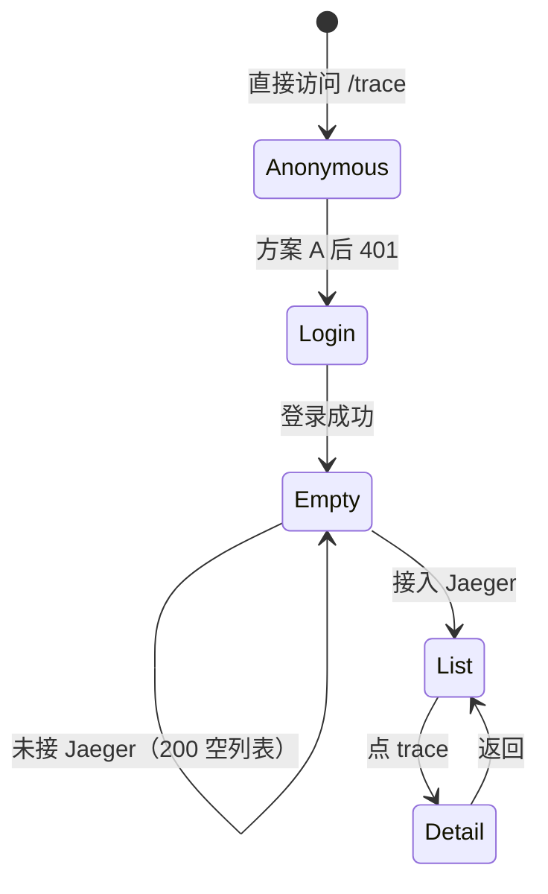
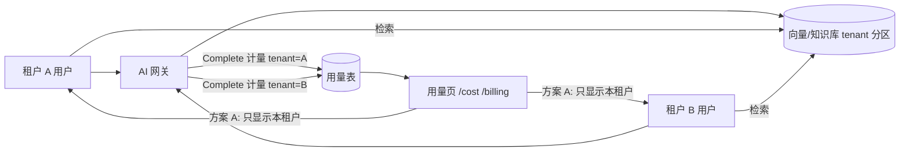

# 立项书 2026-11-05：四项待启动工程与参考选项

> 性质：**立项材料（只读取证 + 规划，不改代码）**。
> 取证基线：`origin/main` `1a2e84f`（2026-11-04T17:07Z 拉取）。
> 关联材料：`docs/decision-materials-2026-11-04.md`（C2/C3/C4 取证）、`docs/tech-debt.md`（TD-60/66/89/97）、`docs/roadmap-2026-10-03.md`（批次划分口径）。
> 本文回答三件事：① 哪些待办该立项；② 每项的参考选项与代价；③ 本线（workbuddy）选哪个（§6，不留给读者猜）。

---

## 0. 立项范围与已立项边界

| 编号 | 工程 | 优先级 | 新立项？ | 现状一句话 |
|---|---|---|---|---|
| **P1** | ops 路由 RBAC 收口 | **P0（安全）** | 是 | 67/94 个 ops 文件 0 权限检查，覆盖 301 条路由注册 |
| **P2** | `/api/services`、`/api/traces` 接门 | P1 | 是 | 4 端点匿名返回 200 空结果 |
| **P3** | TD-97 AI/成本域租户收口 | P1 | 是（TD-97 已登记、未立项） | 预算零调用；三处存储无租户维度 |
| **P4** | TD-89 CI 镜像源 | P1（发布链） | 是（TD-89 已登记、决策未拍板） | 429 假红；TD-94 已缓解构建期，service containers 仍暴露 |
| — | TD-60 阶段 2 | 进行中 | 否 | 已有 `td60-*` 系列立项与 runbook（§5.1） |
| — | TD-66 网关 | 已完成 MVP | 否 | 预览形态是既定决策；完整数据面不启动（§5.2） |

**不放进本文的**：owner 的个人决策项（A2 argocd operator read、A5 `pkg/auth` 删除、A7 v0.17.0 Release 正文）——它们是单点裁决，不是工程；`pkg/auth` 删除本身半天可完成，见 `docs/decision-materials-2026-11-04.md` §2。

---

## 1. P1 ops 路由 RBAC 收口（P0）

### 1.1 事实（现查，统计口径可复现）

- 非测试 `internal/controlplane/*ops*.go` 共 **94** 个。其中 **67 个文件** 的 `requireProd` / `requirePermission` 命中为 **0**，合计 **301 条** `mux.HandleFunc` / `mux.Handle(` 注册；其余 27 个文件含 109 处检查、119 条注册。
- `bd06090` / `1f9e481` 新增的 **17 条 POST 路由全部落在 0 检查文件**：
  - `db_cloud_managed_ops.go` 6 条（Aurora/CloudSQL/AzureSQL/PolarDB/GaussDBDWS/TDSQL-C）；
  - `db_nosql_ext_ops.go` 5 条（HBase/Cassandra/Couchbase/ScyllaDB/CouchDB）；
  - `apache_ext_ops2.go` 3 条（Superset/DolphinScheduler/SeaTunnel）；
  - `elasticsearch_ops_ext.go` 3 条（node-drain/shard-relocate/diagnostic）。
- 下发链：这些 handler 最终走 `dispatchKafkaTask`（`internal/controlplane/kafka_ops.go:29-40`），后者只调 `requireTenantContext`，**不做角色/权限校验**。
- `requireTenantContext`（`internal/controlplane/http_infra.go:129-196`）：`requireAuth: true` 时只保证"有可验证凭证"；`requireAuth: false` 时带任意 `X-Tenant-ID` 头即可（内网直通，注释自陈）。生产 `values-production.yaml:35` 是 `requireAuth: true`。
- 同族对照不是全无守卫：`db_ops.go:169/342/470` 与 `middleware_ops.go:161/345` 有 `requireProd("system:write")`；但 `elk_ops.go` / `apache_ops.go` / `kafka_ops.go` 等家族本身也是 0 检查。**"该加而漏加"与"整族从未加"并存**。
- 命令注入面：`db_nosql_ext_ops.go:58-66` 的 HBase 分支用 `fmt.Sprintf("hbase shell <<< \"create '%s', '%s'\"", table, cf)` 直接拼参数，未走同文件其他分支的 `shellQuote`（:105/:157/:165/:210/:265）。补权限能降低可利用性，但**注入面本身仍在**。

### 1.2 目标 / 非目标

**目标**
1. 生产 `requireAuth: true` 下，写类 ops 路由必须校验权限；viewer 不再能执行系统级运维脚本。
2. 未覆盖数只降不升：新路由必须带检查或显式豁免理由。
3. 对 17 条新路由先止血，不等完整权限矩阵。

**非目标**
- 不改 301 条路由的脚本内容本身（命令注入面的修复单列，见 §1.6）。
- 不引入归属/ABAC 授权。仓库已有裁定：角色矩阵是唯一授权模型（`internal/store/model/perm.go:254-270`）。
- 不在本期做前端按钮级禁用（前端归 zcode；后端 403 是权威）。

### 1.3 方案与取舍

| 方案 | 内容 | 体量 | 收益 | 代价/风险 |
|---|---|---|---|---|
| **A. 止血 + 棘轮** | 17 条新 POST 补 `requireProd("system:write")`；表驱动测试（无凭证 401 / viewer 403 / admin 通过）；新增门禁扫描 `*ops*.go` 写路由，基线=当前 0 检查文件里的写路由数（注册总数 301，含 GET，需先分类）只减不增，按文件豁免记账。**已落地（2026-11-05）**：门禁按 handler 体逐条判读写与鉴权（含同包转手），台账为 **61 个文件 / 284 条未鉴权写路由**（扫描面 408 条注册、124 条已鉴权写路由），见 `internal/gates/ops_route_ratchet_gate_test.go` 与 CHANGELOG 同名块 | 1~2 天 | 与 `db_ops.go` 同族惯例一致；不碰产品语义；当天可落地 | 只关新开的 17 条，旧同族仍开；operator 在这 17 条上从"能做"变"403"（但这 17 条现查无前端调用方） |
| **B1. 全量 `system:write`** | 0 检查文件里的写路由全部补同一权限 | 3~5 天 | 规则最简单，一次收口 | `system` 组不在 operatorGroups ⇒ operator 失去全部 ops 执行面；可能不是产品想要的行为收紧 |
| **B2. 按域授权** | 立域级 execute/写权限（db/middleware/os/k8s/search…），映射 operatorGroups；前端路由门同步 | 3~5 天 + 前端另计 | 语义正确，能保留 operator 的值班能力 | 新增权限点属产品决策；权限目录、种子角色、前端门三处要同批改 |
| **C. 中央 guarded 注册** | `s.guardedOps(mux, path, perm, handler)` 替换裸 `mux.HandleFunc`，让"漏加"在注册期不可能发生 | 2~3 天 | 结构性收口，防复发 | 需改注册方式与测试夹具；与 A/B 正交，适合在 B2 后做 |

**推荐**：**A 立即 → B2 待 owner 矩阵 → C 随 B2**。若 owner 选 B1，A 的 17 条已经按 `system:write` 落地，可直接延续，不用返工。

### 1.4 UI 影响与图

现状请求链（任意已登录用户都能走到 agent）：

```
浏览器（viewer/operator/admin 均可）
  │  POST /api/v1/db/hbase {action:"create", table:"...", cf:"..."}
  ▼
mux.HandleFunc ──► handleDBHBase
                    │ 只做方法判断 + JSON 解码
                    ▼
             dispatchKafkaTask ──► requireTenantContext（只证"登录 + 租户"）
                    │
                    ▼
             createSystemTask ──► agent 执行 shell
```

方案 A 之后：

```
浏览器
  │  POST /api/v1/db/hbase
  ▼
handleDBHBase ──► requireProd("system:write")
                    ├─ 无凭证/无效        → 401
                    ├─ viewer/operator    → 403 + auditAuthzDenied
                    └─ admin              → dispatchKafkaTask → agent
```

UI 门与后端门的关系（现状）：

| 页面 | 前端路由门（`web/enterprise/src/router/index.js`） | 后端现状 | 方案 A 后 |
|---|---|---|---|
| `/system-ops` | `system:write`（:41，admin-only） | 未逐一核 | 页面本就不可见；API 403 兜底 |
| `/middleware` | `deploy:read`（:44） | 部分有 `system:write`，部分 0 检查 | 写操作 403 for 非 admin |
| `/infra-console` | `device:read`（:43） | 同上 | 同上 |
| `/os-optimize` | `task:read`（:40） | 同上 | 同上 |
| `/k8s/*` | `device:read`/`device:write`（:48-51） | 同上 | 同上 |
| 17 条新 API | 无前端调用方（现查 `web/enterprise/src` 无匹配） | 0 检查 | 403 for 非 admin |

按钮语义（给 zcode 的建议，不是本期后端任务）：

```
admin:     [执行] 可点
operator:  [执行] 置灰 + tooltip「需要 system:write」   ← 方案 A 的副作用
viewer:    [执行] 置灰 + tooltip「只读角色」
```

注意：如果产品希望 operator 保留一部分（如 `os:execute` / `middleware:execute`），就走 B2，**不要在前端做假门**——前端门只影响可见性，后端才是授权。

角色 × 动作矩阵：

```
                viewer     operator      admin
读列表/详情       ✅          ✅           ✅
执行 ops（现状）  ⚠️ 可执行   ⚠️ 可执行    ✅        ← 后端无检查
执行 ops（A）     ❌ 403      ❌ 403       ✅
执行 ops（B2）    ❌          按域授权     ✅
```

### 1.5 验收

- 17 条路由表驱动：无凭证 401、viewer 403、admin 200/202；拒绝走 `auditAuthzDenied`。
- 门禁：基线 301 只减不增；删掉任意一条检查即变红（变异验证）。
- 至少 3 个代表域（db / middleware / search）走 httptest 或真进程。
- 不回归：`go test ./internal/controlplane/...`，含既有 `ops_validation_test.go`。

### 1.6 风险与单列项

- **行为收紧**：operator 在这些路由上会从"能做"变 403。上线前用 admin 账号把高频动作走一遍；生产 `requireAuth` 已确认为 true。
- **基线口径**：301 条里混有 GET 路由，门禁必须先按方法分类，别把读路由算进写基线。
- **命令注入面（单列小项）**：`db_nosql_ext_ops.go:58-66` 的 HBase 分支补 `shellQuote`，与同文件其他分支对齐。建议 P1-A 同批做，但不扩大成整个 301 条路由的脚本审计。

---

## 2. P2 `/api/services`、`/api/traces` 接门（P1）

### 2.1 事实

- 4 个端点注册在 `internal/controlplane/server_lifecycle.go:494-497`；handler 在 `internal/controlplane/trace.go:74-128`，全部 graceful 空结果（未接真实 Jaeger）。
- 无认证/权限检查；全局 handler 链没有统一认证中间件（认证由各 handler 自己调）。
- 前端 `/trace` 也无门（`web/enterprise/src/router/index.js:154-156`），注释自陈"后端无守卫，前端门就是虚构的门"。

### 2.2 方案与取舍

| 方案 | 内容 | 体量 | 收益 | 代价/风险 |
|---|---|---|---|---|
| **A. 只补认证** | 4 个 handler 各加 `requireTenantContext` | 0.5 天 | 去掉匿名面；不动权限目录/前端 | 登录用户均可读；仍是"认证 ≠ 授权" |
| **B. 立 `observability:read`** | `PermSpecs` 新增族 + operatorReadOnlyGroups + viewer 派生 + handler `requireProd`；前端路由门同步 | 1.5~2 天（后端） | 语义正确，为真实 Jaeger 接入做准备 | 新权限族属产品决策；前端门归 zcode |
| **C. 改 501** | handler 返回 501 | 0.5 天 | 最诚实，杜绝"空结果当成功" | 前端要处理错误态；用户已接受空态 |
| **D. 维持现状** | 无 | 0 | 零成本 | 匿名 API 面保留 |

**推荐**：**A**。B 等真实 Jaeger 接入 + owner 对 observability 族拍板后再做；C 在空态 UX 被接受的前提下没必要。**A 已落地 2026-11-05**（四端点补 `requireTenantContext`；`handleTraceRouting` 是分派入口，闸加在那里覆盖两个子路径端点）。

### 2.3 UI 状态图



ASCII 版：

```
现在:      匿名 ──GET /api/traces──▶ 200 {"data":[],"total":0}   （无门）
方案 A:    匿名 ──GET /api/traces──▶ 401 ──▶ 登录 ──▶ 200 空列表
接 Jaeger: 登录 ──▶ 列表 ──▶ 详情
```

方案 A 不动前端；方案 B 才需要给 `/trace` 加 `requirePerm: 'observability:read'`（归 zcode）。

### 2.4 验收

- 4 端点无凭证 401；登录后任意角色 200 空结果（不改变现有 UX）。
- 前端 trace 页空态 smoke 不回归。
- 变异：去掉任一 handler 的 `requireTenantContext` → 测试红。

---

## 3. P3 TD-97 AI/成本域租户收口（P1）

### 3.1 事实

- `BudgetManager.RecordUsage`（`internal/cost/handler.go:188`）/ `IsOverBudget`（:253）生产零调用；计数器在内存，重启归零。
- 计量挂点应在 `internal/ai/gateway/gateway.go:149` 的 `Complete` 出口；执法挂点在请求入口。
- 三处共享存储无租户维度：
  - `internal/ai/gateway/rag.go:30-31` `docs map[string]VectorDocument`；
  - `internal/ai/gateway/prompt.go:25-27` `templates map[string]*PromptTemplate`；
  - `internal/knowledge/retrieval.go:252-253` `docs map[string]KnowledgeDoc`。
- `GET /api/v1/ai/usage` 是网关级累计；`TokenUsageTracker` 不分租户。
- cost 侧 tenantId 已以验签上下文为准（`internal/cost/handler.go:580-594` 的 `scopedTenant`）；平台跨租户视图缺显式权限。

### 3.2 方案与取舍

| 方案 | 内容 | 体量 | 收益 | 代价/风险 |
|---|---|---|---|---|
| **A. 最小租户化** | `Complete` 出口按 `authctx.TenantID` 记 tokens；入口按租户 `IsOverBudget` 拦截（先 warn 后 enforce）；`/ai/usage` 默认本租户；vector/prompt/knowledge 三处 map 加 tenant key + 检索按租户过滤 | 3~5 天 | 堵住跨租户数据泄露；预算从"只读展示"变"真计量" | 三处存储要迁移；预算执法口径需 owner 定 |
| **B. 完整平台运营面** | 新增 `platform:admin` 权限族 + 跨租户用量/预算视图 + 审计 + 前端页 | 1~2 周 | 平台运营可看全局 | 属新产品面，无当前需求 |
| **C. 维持现状** | 只补文档声明 | 0 | 零改动 | A 租户的 RAG 文档会出现在 B 的检索结果里；预算永不生效 |

**推荐**：**A**。B 等有平台运营需求再开。

### 3.3 UI 数据流



ASCII 可见性：

```
             现状                方案 A
用量页       网关级总量          本租户（admin 可看平台总量）
知识检索     全局共享            租户隔离
预算         只读展示/不计量     计量 + 入口拦截
```

### 3.4 验收

- 两租户交叉写入/检索：A 的文档不出现在 B 的结果（httptest + 真 store）。
- 预算：超限后入口按产品口径拒绝（429/403）；计量按租户累加。
- 重启后用量不丢（SQL store）；memory 模式明确"重启归零"。
- 现有 `/cost` 页面 smoke 不回归。

### 3.5 风险

- 三处存储改 tenant key 是数据迁移面：memory 无迁移，SQL 需迁移脚本；现网全局数据先归到一个默认租户（不丢数据）。
- 预算执法可能误伤：按 token 还是请求数、超限是拒绝还是仅告警，需 owner 定。

---

## 4. P4 TD-89 CI 镜像源（P1 发布链）

### 4.1 事实

- 429/5xx 发生在 `docker/build-push-action` 解析 FROM 元数据阶段；同一 run 的代码门禁全绿。
- TD-94 已落 `deploy/scripts/docker-pull-retry.sh` + ci.yml/release.yml 五处预热；**残余面**是 `integration`/`services` 的 service containers（`mysql:8`/`redis:7`）由 runner 在 steps 之前预拉取。
- 基础镜像：`node:22-alpine`、`golang:1.26-bookworm`、`debian:bookworm-slim`、`alpine:3.23`（`Dockerfile`、`Dockerfile.agent`、`Dockerfile.service`、`deploy/docker/*`）。
- owner 2026-10-10 明确"不配 secrets"（只读 PAT 也不配），因此选项 A 与既有决定相反。

### 4.2 方案与取舍

| 方案 | 内容 | 体量 | 收益 | 代价/风险 |
|---|---|---|---|---|
| **A. Docker Hub 只读 token** | `docker/login-action` 注入 secret | 0.5 天 | 认证配额显著提升；不动 Dockerfile | 需要 owner 反转"不配 secrets" |
| **B. 公共镜像源** | 基础镜像改 `mirror.gcr.io` 等；service containers 同步 | 1~2 天 | 无需凭据，绕开 Docker Hub 限额 | 第三方源信任与可用性；必须逐 tag 做 digest 对照 |
| **C. 维持现状 + 重跑** | 已有 TD-94 有界重试；失败自动重跑 | 0 | 零改动 | 随机红继续；发布线仍可能被限流挡住 |
| **D. 自建/GHCR 缓存** | 基础镜像镜像到自有 registry | 3~5 天 + 长期维护 | 供应源可控 | 维护成本最高 |

**推荐**：**B**。A 需要 owner 反转既有决定；C 是当前兜底；D 只在镜像量大到值得维护时考虑。

B 的验收（缺一不可）：

- 每个 tag 在 Docker Hub 与镜像源的 **manifest digest 相等**（脚本化对照，留证据）。
- CI runner 对镜像源可达（真实一次构建/预拉）。
- 切换后一次完整 release-dryrun/CI 绿。
- 保留 Docker Hub 路径作为回退（workflow env 可切）。

### 4.3 UI

本项不涉及前端，无图。

---

## 5. 已立项 / 不重立

### 5.1 TD-60 阶段 2（进行中）

- 已有材料：`docs/td60-decision-2026-09-26.md`、`td60-cutover-plan.md`、`td60-auth-cutover-runbook.md`、`td60-domain-convergence-analysis-2026-10-11.md`。
- 当前残余约 **5,980 行**（较原 27,000 行降 78%）；下一步按收敛分析：auth 先走通（零代码，等用户名单）→ task leader 切换 → HTTP 切 → agent 适配 → device 下沉+切。
- **不重立**；执行项归 TD-60 现有立项。

### 5.2 TD-66 网关

- MVP 四件（路由持久化/熔断/Prometheus 埋点/超时）已于 2026-10-11 落地验收（`27ea687` + `0f57052`）。
- 生产对外流量仍按 2026-09-05 决策走 APISIX/Envoy；本网关定位"内部轻量路由编排预览"。
- 完整数据面（多后端/gRPC/OPA/WebSocket/主动健康检查）**不立项**，除非 owner 明确要替代外部网关。
- 若重开，现有 UI 页面 `/gateway-routes`（`gateway:read`）草图：

```
┌─ API 网关路由 ──────────────────────────────┐
│ [+ 新建路由]   租户: 当前租户 ▼              │
│ ┌──────────┬──────────┬────────┬────────┐  │
│ │ 路径前缀  │ 目标后端  │ 限流/s │ 状态   │  │
│ ├──────────┼──────────┼────────┼────────┤  │
│ │ /api/a   │ http://… │ 100    │ 启用   │  │
│ └──────────┴──────────┴────────┴────────┘  │
│ 统计: requests_total / latency / 429        │
└─────────────────────────────────────────────┘

数据面边界:
客户端 → /gw/ → 匹配 → 限流 → 代理 → 后端
（鉴权/租户隔离/SSRF 已在岗；熔断/超时/metrics 已补）
```

### 5.3 v0.17.0 Release 正文

- 属 owner 的发布决策（冻结纪律），不是工程立项，不在本文展开。

---

## 6. 本线（workbuddy）的 A/B 决断

| 事项 | 可选 | **我选** | 理由 | 是否需要 owner |
|---|---|---|---|---|
| ops RBAC | A 止血+棘轮 / B1 全量 / B2 按域 / C 中央包装 | **A 立即**；B2 待矩阵；C 随 B2 | A 与 `db_ops.go` 同族一致、纯收口；B 改角色可执行面属产品语义 | A 不需要；B2 需要 |
| trace 端点 | A 只认证 / B 立权限族 / C 501 | **A** | 4 端点是无数据 stub；B 要新权限族 + 前端门（zcode）；A 当天可完成 | A 不需要；B 需要 |
| TD-97 | A 最小租户化 / B 平台运营面 / C 维持 | **A** | 租户隔离是数据面缺陷，不是新功能；B 无当前需求 | A 的预算口径需要 owner 确认 |
| TD-89 | A token / B 镜像源 / C 重试 / D 缓存 | **B** | owner 已明确不配 secrets；B 可独立做 digest 对照 | 需要确认接受镜像源 |
| TD-60 | — | **已立项，不重立** | — | — |
| TD-66 | — | **不重立** | 预览形态是既定决策 | 重开才需要 |

---

## 7. 执行顺序（下一个窗口）

1. **P1-A**：17 条止血 + 表驱动测试 + 门禁基线（约半天）。**已落地 2026-11-05**（`ops_route_authz_test.go` 7 例 + `ops_route_ratchet_gate_test.go` 棘轮，含内存变异反证）。
2. **P2-A**：4 端点 `requireTenantContext` + 测试（约半天）。**已落地 2026-11-05**（匿名由 200 空结果改 401，登录态空态 UX 不变）。
3. P1 门禁接入 CI（与 1 同批，避免"新增了一批路由但门禁没长眼睛"）。**已落地**：`internal/gates` 整包随既有 `build-test` 腿跑。
4. **等 owner**：P1-B2 矩阵、P3 预算口径、P4 镜像源确认。
5. P3-A 在口径确认后启动（3~5 天）。

---

## 8. 需要 owner 回答的问题

1. **P1**：operator 是否保留部分 ops 执行面？若保留，按哪些域（os/middleware/db/search…）？若不保留，全部 `system:write`（admin-only）是否可接受？
2. **P2**：observability 是否现在立权限族，还是等 Jaeger 接入？
3. **P3**：预算执法口径（token 还是请求数？超限拒绝还是仅告警？）；平台跨租户视图是否需要？
4. **P4**：是否接受 `mirror.gcr.io` 作为基础镜像源（附 digest 对照证据）？
5. **P3 数据归属**：现有全局 RAG/提示词/知识库数据迁到哪个默认租户？

---

## 9. 未核清单与复现命令

**未核**
- 301 条 ops 路由未逐条判定"读/写/是否真的执行命令"；本文只按文件级 0 检查统计。
- 17 条新路由现查无前端调用方，但不排除外部脚本/第三方调用。
- TD-89 镜像源未做连通性与 digest 实测。
- TD-97 三处存储的 SQL 实现与迁移面未逐文件核对。

**复现**

```bash
# P1：0 检查的 ops 文件与路由数（排除 _test.go）
files=$(ls internal/controlplane/*ops*.go | grep -v _test.go)
for f in $files; do
  c=$(grep -c "requireProd\|requirePermission" "$f")
  r=$(grep -c "mux.HandleFunc\|mux.Handle(" "$f")
  echo "$c $r $f"
done | awk '$1==0 {n++; r+=$2} END {print "zero_check_files="n, "routes="r}'

# P1：17 条新路由与检查数
for f in db_cloud_managed_ops.go db_nosql_ext_ops.go apache_ext_ops2.go elasticsearch_ops_ext.go; do
  echo "$f routes=$(grep -c 'mux.HandleFunc' internal/controlplane/$f) checks=$(grep -c 'requireProd\|requirePermission' internal/controlplane/$f)"
done

# P1：下发链只校验租户
sed -n '29,40p' internal/controlplane/kafka_ops.go

# P2：4 个端点
grep -n "api/services\|api/traces" internal/controlplane/server_lifecycle.go

# P3：预算零调用
grep -rn "RecordUsage\|IsOverBudget" --include=*.go internal | grep -v _test

# P4：基础镜像清单
grep -n "^FROM" Dockerfile Dockerfile.agent Dockerfile.service deploy/docker/*
```
